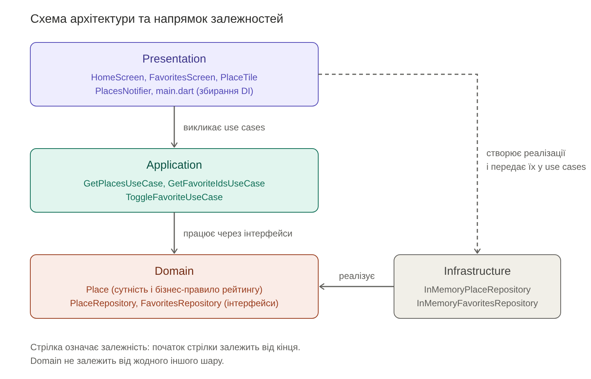

# Туристичний путівник

Навчальний застосунок на Flutter для лабораторної роботи №5. Показує список туристичних місць і дозволяє додавати їх в обране. Проєкт побудований за принципами Clean Architecture.

## Архітектура



Усі залежності спрямовані до домену:

- Presentation: екрани, PlacesNotifier (Provider) і main.dart, де збираються залежності
- Application: use cases GetPlacesUseCase, GetFavoriteIdsUseCase, ToggleFavoriteUseCase
- Domain: сутність Place та інтерфейси PlaceRepository, FavoritesRepository
- Infrastructure: реалізації репозиторіїв у пам'яті

## Структура проєкту

```text
lib/
  config/app_config.dart
  domain/entities/place.dart
  domain/repositories/place_repository.dart
  domain/repositories/favorites_repository.dart
  application/use_cases/get_places_use_case.dart
  application/use_cases/get_favorite_ids_use_case.dart
  application/use_cases/toggle_favorite_use_case.dart
  infrastructure/repositories/in_memory_place_repository.dart
  infrastructure/repositories/in_memory_favorites_repository.dart
  presentation/providers/places_notifier.dart
  presentation/screens/home_screen.dart
  presentation/screens/favorites_screen.dart
  presentation/widgets/place_tile.dart
  main.dart
```

## Збірка і запуск

1. Встановити Flutter SDK.
2. У каталозі проєкту виконати `flutter create .` (додасть папки платформ, файли lib/ і pubspec.yaml залишаться без змін).
3. Виконати `flutter pub get`.
4. Запустити застосунок командою `flutter run`.

## Тести

- Unit-тести: `flutter test test/ --coverage`
- E2E на Windows: `flutter test integration_test -d windows`
- Maestro на Android (потрібен емулятор або телефон із встановленим APK): `maestro test .maestro/favorites.yaml`

Команда `flutter create .` додає файли `test/widget_test.dart` і `analysis_options.yaml`, через які `flutter analyze` завершується з помилкою. Їх треба видалити.

CI описаний у `.github/workflows/tests.yml`: unit-тести запускаються на кожен push і pull request, E2E лише для pull request.

## Гілки

- main: стабільний код, релізи позначені тегами (v1.0.0)
- develop: інтеграційна гілка
- feature/*: гілки під окремі задачі, по одній на кожен шар
